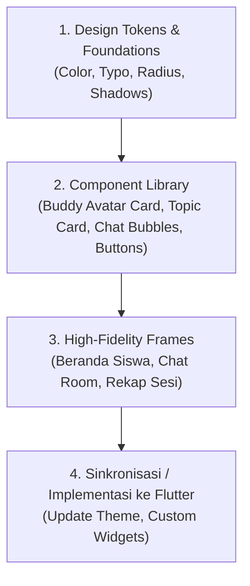

# 🎨 Draft Plan Desain UI/UX — Learn Buddy

> **Tujuan:** Mengubah tampilan aplikasi dari gaya *form-like / polos* menjadi aplikasi belajar interaktif yang hidup, ramah anak SMK, dengan menonjolkan persona **Buddy** sebagai teman belajar.

---

## 1. Analisis Masalah Tampilan Saat Ini (Current State)
1. **Beranda Terlalu Kosong & Rata:**
   - Tidak ada kehadiran visual karakter Buddy di halaman utama.
   - Kartu Topik dan Riwayat Sesi warnanya monoton (putih dengan outline tipis).
   - Tipografi header belum memiliki ritme visual yang menarik.
2. **Kartu Topik Kurang Mengundang (*Call to Action*):**
   - Belum ada ilustrasi/ikon khas topik (misal: tumpukan piring/buku untuk Stack, rantai/gerbong kereta untuk Linked List).
   - Tombol *"Mulai Sesi Baru"* warnanya solid datar.
3. **Riwayat Sesi:**
   - Masih berbentuk list sederhana, belum menunjukkan badge status yang membanggakan (misal: *Badge Tuntas*, persentase dengan progress ring melingkar).

---

## 2. Arah Gaya Desain Baru (Dual Theme Capsule Glassmorphism)
Aplikasi mendukung **Dua Tema Kaca (Dual Theme Glassmorphism)** yang dapat diubah siswa kapan saja melalui Pengaturan:

1. **Tema Gelap (Dark Glassmorphism — Default):**
   - **Background:** *Radial Midnight Slate* (`#17384A` ➔ `#0F172A`) dengan bias cahaya cyan/ungu lembut (*ambient glow orbs*).
   - **Permukaan Kaca:** Gelap semi-transparan (`rgba(30, 41, 59, 0.45)`) dengan border tipis mengkilap.
   - **Kesan:** Futuristik, nyaman untuk mata di malam hari, sangat menonjolkan avatar Buddy.
2. **Tema Terang (Light Glassmorphism / Frost Mode):**
   - **Background:** *Soft Sky to Crisp Slate* (`#E0F2FE` ➔ `#F1F5F9`) dengan bias cahaya biru muda segar.
   - **Permukaan Kaca:** Kaca susu transparan putih (`rgba(255, 255, 255, 0.65)`) dengan bayangan halus elegan dan border putih bersih.
   - **Kesan:** Segar, ramah, bersih, dan sangat nyaman dibaca saat siang hari.

---

### D. Layar Pengaturan & Edit Profil (Akses via Tap Kartu Profil Siswa)
1. **Ganti Foto Profil:** Avatar bulat besar dengan tombol kamera.
2. **Identitas Siswa:** Input Nama Lengkap (*Ahmad Farid Hernacqi*) & Asal Institusi/Sekolah.
3. **Switch Tema Tampilan (Dark / Light):**
   - Tombol toggle kapsul: `🌙 Gelap (Dark)` vs `☀️ Terang (Light)`.
   - Mengubah seluruh palet aplikasi secara instan.
4. **Pilihan Bahasa Aplikasi:** `🇮🇩 Indonesia` vs `🇬🇧 English`.
5. **Tombol Simpan & Logout (Keluar Akun).**

---

## 3. Rencana Komponen Layar (Screen by Screen)

### A. Bottom Navigation Bar — Floating Capsule Glassmorphism (Sesuai Referensi)
Bentuk navigasi bawah beralih dari bar penuh menjadi **Kapsul Melayang (Floating Pill Capsule)** dengan efek *Frosted Glass / Glassmorphism*:
1. **Dukungan Interaksi Swipe / Drag (Geser Layar):**
   - Siswa bisa **menggeser layar ke kiri atau kanan (Horizontal Swipe)** untuk berpindah antar menu utama: `Chat Buddy ⇄ AR 3D ⇄ Dashboard` (di Flutter diimplementasikan menggunakan `PageView` / `TabBarView`).
   - Indikator kapsul aktif di bawah akan otomatis meluncur (*smooth slide transition*) mengikuti arah geseran jari.
2. **Desain Kapsul Melayang:**
   - Background kapsul: Gelap semi-transparan (`rgba(30, 41, 59, 0.78)`) dengan efek blur latar (*Backdrop Filter Blur 20px*).
   - Border halus tipis dengan bayangan lembut mengambang di atas konten halaman.
3. **Indikator Tab Aktif (Active Glowing Pill):**
   - Tab yang sedang dipilih memiliki kapsul latar terang menyala (*inner glow pill*) dengan border kaca tipis.
4. **Segmented Control Geser pada Settings:**
   - Tombol pilihan **Tema (Gelap / Terang)** dan **Bahasa (ID / EN)** mendukung gesture geser (*drag pill*) selain tap langsung.

---

### B. Layar Chat Buddy / Hub Kursus (Tab 1) — Prioritas 1
Hierarki navigasi dirancang 2 tingkat agar aplikasi fleksibel dan *scalable*:
`Tab Chat Buddy (Katalog Mapel/Kursus) ➔ Layar Topik (Stack, Queue, dll.) ➔ Ruang Chat Buddy`

1. **Header Interaktif (Buddy Greeting Hero Card):**
   - Hero Card dengan avatar **Buddy (ekspresi Senang/Menyapa)** di sebelah kanan.
   - Balon ucapan: *"Halo, Kak Farid! Mau ajarin Buddy mapel apa hari ini?"*
   - Ringkasan cepat progres belajar siswa.
2. **Katalog Mata Pelajaran (Course Cards):**
   - **Struktur Data (Aktif):** Ikon struktur data/tumpukan balok, progress meter aktif, badge *"1 Topik Berjalan"*. Saat di-tap, membuka halaman detail berisi topik: Stack, Linked List, Queue, dll.
   - **Pemrograman Python (Coming Soon / Siap Diisi):** Ikon Python khas, badge *"Segera Hadir"*.
   - **Pemrograman Java (Coming Soon / Siap Diisi):** Ikon secangkir kopi khas Java, badge *"Segera Hadir"*.
   - *(Desain modular: guru/admin bisa menambahkan mapel baru kapan saja).*
3. **Layar Detail Topik (Ketika Kartu Mapel Di-tap):**
   - Berisi daftar topik spesifik materi tersebut (misal untuk Struktur Data: **Stack**, **Queue**, **Linked List**).
   - Di sini siswa melihat kartu topik lengkap dengan Meter Pemahaman terbaik, badge status (*Sedang Berjalan* / *Tuntas*), dan tombol *"Mulai Sesi Baru"*.
   - Riwayat sesi belajar untuk topik yang bersangkutan.

---

### C. Layar Dashboard / Pusat Bahan Ajar (Micro-LMS Companion)
Dashboard diubah menjadi **Hub Bahan Ajar & Evaluasi Terpadu (LMS)** untuk melengkapi riset mata kuliah Pengembangan Bahan Ajar:

1. **Header Hero Card Profil Siswa (Tappable / Bersih):**
   - Menampilkan Nama Lengkap (*Ahmad Farid Hernacqi* 🎓), identitas sekolah/kampus, dan level apresiasi.
   - Ketuk di mana saja pada kartu untuk masuk ke **Pengaturan, Edit Profil, Switch Tema & Bahasa**.
2. **Komponen Inti LMS (Bahan Ajar & Asesmen Terstruktur):**
   Ketiga menu LMS di Dashboard dirancang menggunakan alur bertingkat:
   `Pilih Menu LMS (E-Modul / Kuis / Refleksi) ➔ Pilih Mata Pelajaran (Struktur Data, Python, Java) ➔ Konten Bab/Latihan`

   - 📖 **E-Modul & Materi Bacaan:** Saat diklik, siswa memilih mata pelajaran (misal: *Struktur Data*), lalu membaca rangkuman teori bab & ilustrasi konsep sebelum mengajar Buddy.
   - ⚡ **Kuis Formatif (Pre-Test & Post-Test):** Saat diklik, siswa memilih mapel lalu mengerjakan 5 soal objektif cepat per materi.
   - 📝 **Tugas Refleksi Mengajar:** Lembar evaluasi mandiri per mapel untuk menyimpulkan pembelajaran.
3. **Alat Bantu Belajar:**
   - 📚 **Glosarium IT:** Kamus istilah Struktur Data (LIFO, Push, Pop, Head, Node, dsb.).
   - 🏆 **Pencapaian & XP:** Koleksi lencana capaian belajar siswa.
   - Grid 2 kolom kartu menu interaktif yang siap dikembangkan (misal: *Glosarium Struktur Data*, *Petunjuk Penggunaan Media*, *Profil & Akun*, dll.).
   - Desain fleksibel sehingga bisa ditambah atau dikurangi kapan saja.

---

### B. Layar Mengajar / Chat (Chat Screen) — Prioritas 2
1. **Sticky Top Bar Dashboard:**
   - Avatar ekspresi Buddy yang **bisa bergerak/animasi halus** saat meter bertambah.
   - Meter Paham bukan garis tipis, tapi kapsul progress dinamis dengan persentase besar.
   - Chip kriteria (misal: `3/9 Konsep Terpenuhi`) yang bisa di-tap untuk melihat modal kriteria (tanpa spoiler jawaban).
2. **Chat Bubble Styling:**
   - **Buddy Bubble (Kiri):** Latar soft teal/white dengan avatar Buddy mini di sampingnya, aksen border halus.
   - **Student Bubble (Kanan):** Gradasi teal ke cyan dengan teks putih bersih.
   - Animasi *typing indicator* tiga titik melompat saat Buddy berpikir.
3. **Input Bar:**
   - Input melayang (*floating pill bar*) dengan tombol kirim berlingkar ikon pesawat kertas yang menonjol.
   - Penghitung karakter (misal `23/800`) dibuat lebih subtle di pojok bawah.

---

### C. Layar Rekap / Hasil Belajar (Recap Screen) — Prioritas 3
1. **Celebration Card:**
   - Avatar Buddy Full Body / pose Sangat Senang (jika tuntas) atau pose Penasaran.
   - Nilai Akhir (Skor %) besar di tengah dengan efek badge prestasi.
2. **Breakdown Kriteria:**
   - Daftar miskonsepsi yang berhasil diluruskan dengan tanda centang hijau glowing.
   - Kutipan terbaik siswa saat menjelaskan (*"Kata-katamu yang paling bikin Buddy paham"*).

---

## 4. Rencana Kerja di Figma (Figma Roadmap)

---

## 5. Pertanyaan untuk Diskusi:
1. Apakah kamu ingin kita siapkan file Figma baru (bisa dibuatkan frame dasarnya atau Code Connect), atau kamu sudah punya file Figma sendiri yang ingin dipakai?
2. Untuk layout topik di Beranda, kamu lebih suka **kartu vertikal (scroll ke bawah)** seperti sekarang, atau **horizontal carousel card** (geser samping seperti aplikasi mobile modern)?
